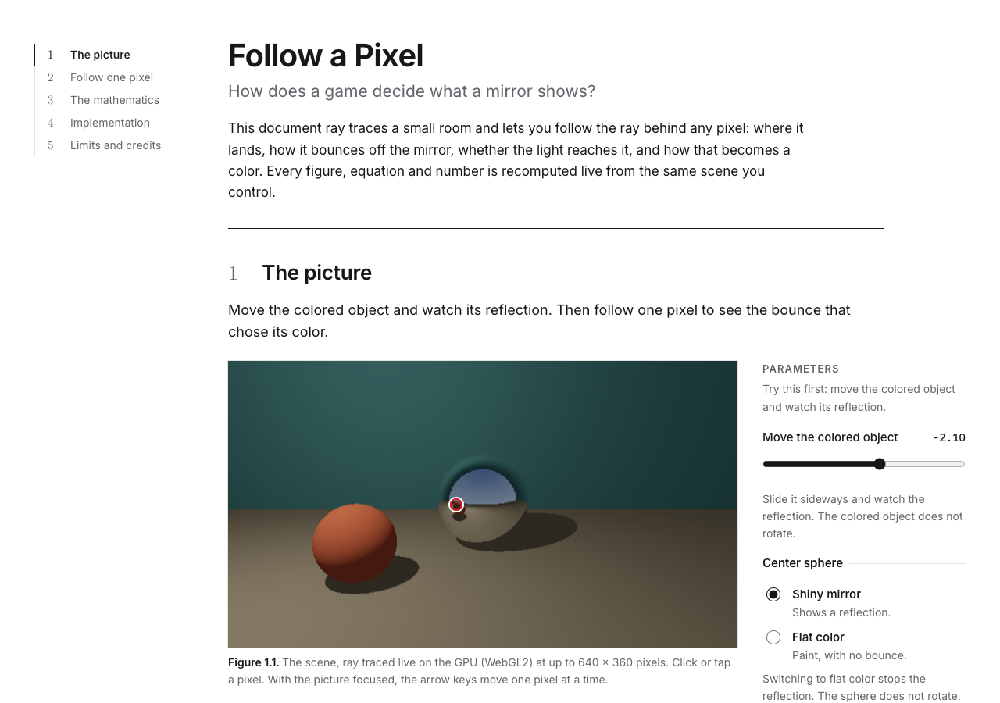
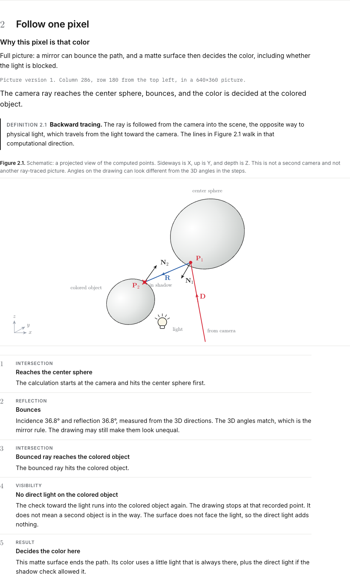
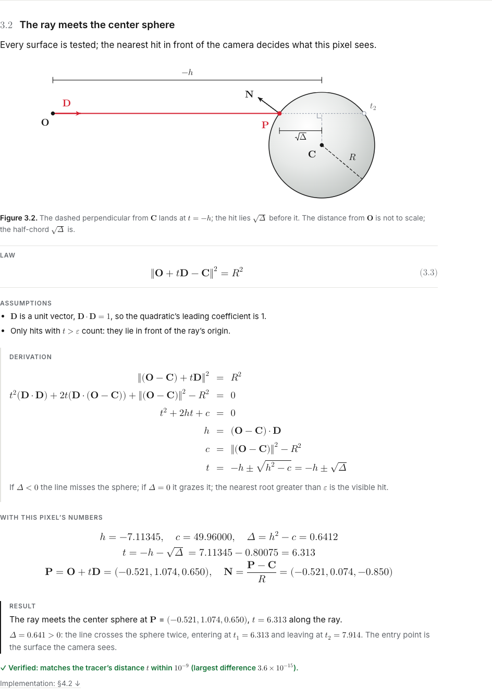
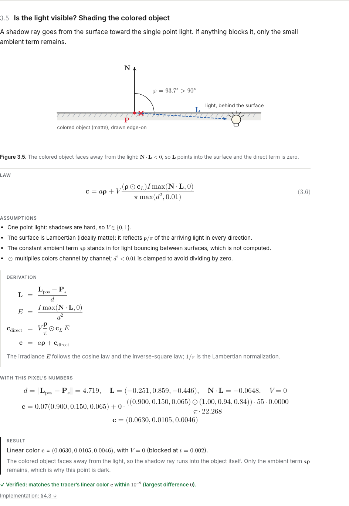
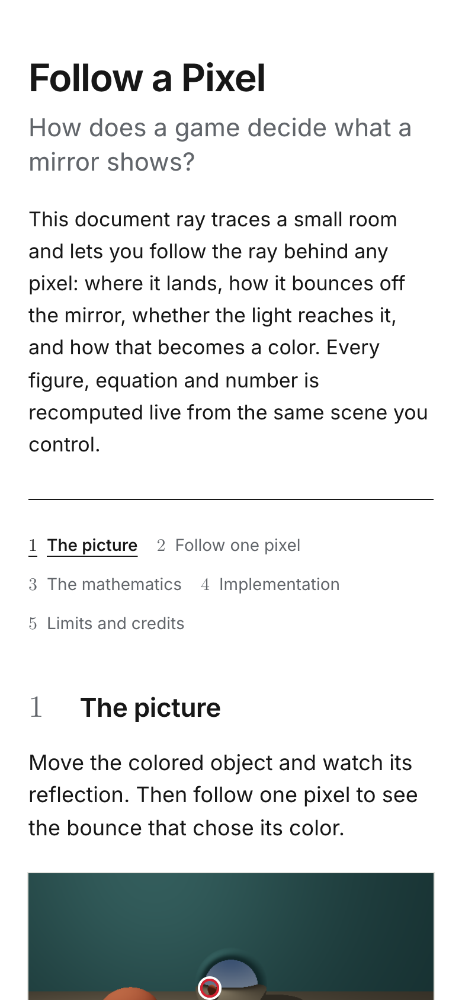

# Handoff: editorial interface (phase P7)

For **AI 2**, who owns `src/ui/**`, `src/styles/**` and `tests/ui/**`, and for **AI 3**, who
integrates. The design and the rules it follows are in
[`editorial-ui-brief.md`](editorial-ui-brief.md). This note covers what was delivered, how it
was checked, and what is still open.

## 1. Branch, base, contract

- Branch **`feature/editorial-ui`**, based on `main` at `b46bd9c` (the README edits included).
  The branch never touches `README.md`.
- Contract **v1 unchanged**. No edits to `src/contracts.ts`, `src/core/**`, `src/state/**`,
  `src/render/**`, `src/main.ts`, `index.html` or `package.json`.
- It merges with **`feature/renderer-core`** without conflicts, and every suite passes on
  the merged tree (§4). `renderer-core` predates PR #3, so `main` can no longer
  fast-forward to it; it needs a real merge.

| Commit | Phase |
|---|---|
| `6994962` | Brief (this redesign, written as a prompt) |
| `13bf158` | P1 Foundations: tokens, bundled fonts, paper theme |
| `2107ab9` | P2 Editorial structure: chapters, index, numeric pixel selector, numbering |
| `26e3299` | P3 Figure 2.1 as an SVG schematic; steps as a derivation |
| `34e7a54` | P4 Chapter 3 as a derivation chapter |
| `f1ea9d2` | P5 Reactive figures and linked highlighting |
| `075f614` | P6 Chapter 4: the real CPU and GPU source |
| `297957e` | Implementation record; AA contrast for code line numbers |
| `d43e574` | P7 review fixes: the shading law divides by π; substitutions reproduce (§3) |

## 2. What changed, by file

| File | Role |
|---|---|
| `src/styles/tokens.css` (new) | Colour, spacing and type tokens. One meaning per accent (brief §4.1). |
| `src/styles/fonts.css`, `src/styles/fonts/` (new) | Inter, IBM Plex Mono and *FAP Math* (a Latin Modern Math subset that keeps its MATH table). Bundled; licences beside the files. |
| `src/styles/main.css` | Paper theme and the document layout. Rules instead of cards. |
| `src/ui/index.ts` | Chapters 1–5, sticky index with scroll-spy, numeric pixel selector, subordinate parameters. `mountUI` signature unchanged. |
| `src/ui/diagram.ts`, `schematic-geometry.ts` (new) | Figure 2.1 as SVG, drawn only from `explain.ts`'s `DiagramPlan`. Spheres are exact projected ellipses. Draggable object and light. |
| `src/ui/math-panel.ts`, `math-figures.ts`, `mathml.ts` | Chapter 3: per operation, purpose → figure → caption → law (numbered) → assumptions → derivation → numbers → result → interpretation → ✓ check. |
| `src/ui/precision.ts` (new) | How many decimals a substitution line prints, so the printed arithmetic reproduces the printed result (§3). |
| `src/ui/source-view.ts`, `source-extract.ts` (new) | Chapter 4. CPU listings from `src/core/*.ts?raw`, GPU listings from `buildTraceFragmentSource()`. Shown in `<code class="listing">`, never `<pre>`. |
| `tests/ui/*.test.ts` | +3 Node suites (schematic geometry, source extraction, precision). AI 2's `explain.ts`, `selection.ts` and `interface.test.ts`, and the `math-model` tests, are byte-identical to `main`. |
| `tests/ui/editorial.browser.mjs` (new) | 8 browser checks: integration hooks, document structure, numeric selector, the two draggable figures (pointer and keyboard), linked highlighting, the listings, and the typeset shading law. |

**How to extend it.** A chapter-3 section is one `ch.add({ title, purpose, figure, caption,
blocks })` call in `math-panel.ts`, where the blocks are `law`, `assume`, `derive`, `numbers`,
`result` and `check`. Every number must come from `buildMathStory(view)`; never store one. To
link an equation term to a figure element, give both the same `data-ref`. Figures are rebuilt
on every update, so attach listeners and pointer capture to the persistent hosts, as
`index.ts` does.

## 3. Defects found in the P7 review, and fixed

1. **The typeset shading law was missing 1/π.** Law (3.6) and its numbers line printed
   `aρ + V(ρ⊙c_L)·I·max(N·L,0)/max(d²,0.01)`. Contract v1, the CPU tracer, the GPU shader and
   the panel's own model all use `ρ/π`. The ✓ check compares the model with the tracer, never
   the typeset equation, so nothing caught it. **This defect is live on `main` today** (from
   PR #3, `c115b52`). Merging this branch fixes it. A browser test now reads the rendered law.
2. **Printed substitutions did not reproduce.** Inputs were printed at 3 decimals, and the
   arithmetic cancels (Δ = h² − c with h² ≈ 50) or divides (t = numerator/denominator). For
   pixel (286, 180): 7.113² − 49.960 = 0.6348, but the printed (correct) Δ was 0.6412. Over a
   24,684-solve grid, **99.4%** of sphere Δ lines and **92.2%** of plane t lines could not be
   reproduced from their own printed numbers. `precision.ts` now prints the fewest decimals
   (3 to 8) that reproduce the result, and prints ≈ if none do. It typically uses 5 decimals
   for spheres and 4–5 for planes. Shading lines already reproduce to within one unit in the
   last digit once π is included, so they were left alone.

Both new tests were checked by mutation: they fail on the old behaviour.

## 4. Checks run (all on 24 Nov 2026, Node 26.4.0, Chrome 158, Apple M5)

| Check | Branch `d43e574` | Merged with `feature/renderer-core` |
|---|---|---|
| `npm run typecheck` | ✓ | ✓ |
| `npm test` (AI 3) | 31/31 | 31/31 |
| `node --test "tests/ui/*.test.ts"` | 25/25 | 25/25 |
| `node --test "tests/render/*.test.ts"` | (not on this base) | 7/7 |
| `npm run build` | ✓ | ✓ |
| `npm run test:browser` (AI 3) | 10/10 | 10/10, CPU/GPU parity max byte difference 0 |
| `node --test tests/ui/editorial.browser.mjs` | 8/8 | 8/8 |
| `npm run test:renderer` | 26/26 + smoke | 16/16 |

Also run on the branch:
- Every control was driven through its visible label: object, flat/mirror, camera, light,
  bounces 0 and 4, view modes, click, arrow key, Reset. Each one produced a new scene
  version and a changed image.
- At both 1280 px and 390 px: all three fonts loaded, no request left localhost, no
  horizontal page overflow, no console warnings or errors, exactly one hidden `<pre>`, and the
  first `<canvas>` is the image.
- Screenshots below, reviewed by eye.

| 1280 px, chapter 1 | 1280 px, Figure 2.1 and the steps |
|---|---|
|  |  |
| **1280 px, §3.2 numbers (reproducible)** | **1280 px, §3.5 shading with 1/π** |
|  |  |

390 px, top of the page: 

## 5. Not verified, and known limits

- **Safari, Firefox and real phones were not tested.** Chrome only. MathML rendering differs
  most between engines. Browsers without MathML Core would need KaTeX (brief §5.1).
- **On phones, long equation lines scroll sideways inside their block.** MathML Core has no
  automatic line breaking, so the §3.2 numbers line and the derivations need a sideways swipe
  at 390 px. The page itself never scrolls sideways. A fix would split substitution lines at
  their commas below a breakpoint.
- **AI 3's browser suite passes 10/10 here only because of the test viewport.** `fitBuffer`
  still floors the buffer height (640×359 on many hosts); the `Math.round` fix in
  `src/core/frame.ts` is still needed.
- The scroll-spy, drags and linking were tested in headless Chrome with a mouse and
  keyboard, not with touch hardware or a screen reader.

## 6. Requests

**For AI 3** (files the interface does not own):
1. Merge this branch and `feature/renderer-core`. They don't conflict; tested together in §4.
2. Add `"tests/ui/*.test.ts"` (and `"tests/render/*.test.ts"`) to `npm test`. CI skips them
   today.
3. Add a script for `node --test tests/ui/editorial.browser.mjs`, or fold it into
   `test:browser`.
4. `fitBuffer`: `Math.floor` → `Math.round` (§5).

**For the human lead:**
5. The README now titles the project *"How does the RTX work? …"*, but the page still says
   *Follow a Pixel*. Which should the page show?
6. The older `docs/readme` branch now conflicts with your README edits on `main`. It is
   probably superseded; delete it if so.

## 7. Attribution

Fonts: Inter and IBM Plex Mono (SIL OFL 1.1); FAP Math, derived from Latin Modern Math (GUST
Font License). Licences and the derivation note are in `src/styles/fonts/`; these four font
files are the only binary assets the branch adds besides its screenshots. The design
specification names Scratchapixel, Distill, Penrose, Bartosz Ciechanowski, Red Blob Games,
Byrne's Euclid and *Physically Based Rendering* as stylistic inspiration only.
